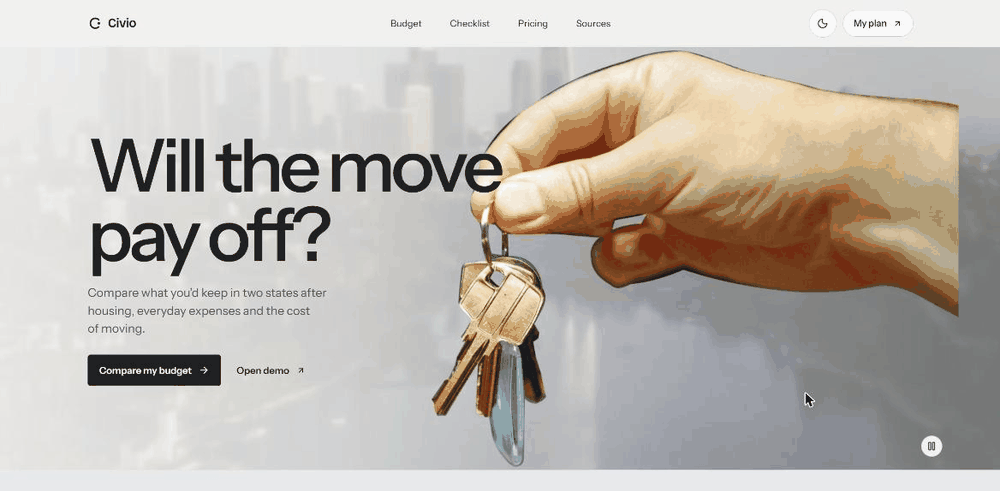

# Civio

Civio helps a household work out whether a move to another US state pays off, and then walks it through the paperwork the move brings: taxes, health insurance, vehicle registration and school enrollment.

<picture>
  <source media="(prefers-color-scheme: dark)" srcset="docs/civio-demo-dark.gif">
  
</picture>

The recording follows your GitHub theme. Both versions: [light](docs/civio-demo-light.gif), [dark](docs/civio-demo-dark.gif). Live demo: https://civio-1008637543619.us-central1.run.app/

## Contents

- [What Civio is](#what-civio-is)
- [Run it](#run-it)
- [Screens](#screens)
- [How it works](#how-it-works)
- [Pricing](#pricing)
- [What is verified, and what is not](#what-is-verified-and-what-is-not)
- [Stack](#stack)
- [Deploy on Google Cloud Run](#deploy-on-google-cloud-run)

## What Civio is

A move to another state raises two questions at once. Will the household have more or less money after it? And what has to be filed, changed or cancelled, and by when? The answers are spread across state and federal sites, and each state has its own deadlines. Civio puts the budget and the paperwork in one plan.

### Who it is for

A household that is planning a move between US states, or is still choosing between up to three destinations. The demo follows a family going from Texas to California.

### What you put in

- What you take home each month now and what you expect after the move.
- Housing, other living costs and the one-time cost of the move itself.
- A few facts about the household: work, children, health insurance, a car.

You can answer step by step, describe the move in your own words, or upload a photo of a license, insurance card or lease. Skipping a question is allowed. Civio then marks the tasks that depend on it as "Needs verification" and does not guess.

### What you get back

| | |
|---|---|
| First-year outlook | How much cash the move adds or takes away over 12 months, moving costs included, and the take-home pay you would need to keep today's monthly balance. |
| Destination comparison | The same numbers for up to three states side by side. |
| Checklist | Tasks for taxes, health insurance, vehicle paperwork and school enrollment. Each has a date counted from your move date, the steps, the documents to bring and a link to the official page. Tasks appear in the order you can actually do them. |
| Cost calculator | The fees your tasks involve, each linked to the page that states the amount. You enter the amounts and Civio totals them. |
| Who to notify | A list of the offices and companies that need your new address. |
| Letters and forms | Change-of-address letters filled from your answers, and the official IRS Form 8822 filled in the browser. |
| Reminders | An email 7, 3 and 1 days before a deadline, if you ask for them. |
| Assistant | Plain-language answers about your tasks, each with links to the official text it came from. |

### What it does not do

Civio gives general information. It is not legal, tax or insurance advice. It has checked rules for five states so far (California, Texas, Florida, Washington and New York) and says so when a state is not covered. It stores no fee amounts. There are no accounts: a plan lives in your browser and under an anonymous link you can open on another device.

The plan, the assistant, the cost calculator and the who-to-notify list are free. Letters are a paid add-on, and checkout is a demo for now. Details are under [Pricing](#pricing).

### How much of it is AI

Requirements, deadlines, task order and totals come from a rule base and plain code. A model reads free text, explains rules and rewrites letters. Every AI feature has a rule-based fallback, so the app works with no API key at all.

## Run it

```bash
npm install
npm run dev        # http://localhost:3000
npm test           # rule engine, intake parser, costs, arrival check, documents
npm run typecheck
```

AI is optional. Copy `.env.example` to `.env.local` and set one key:

| Variable | Provider |
|---|---|
| `GOOGLE_API_KEY` | Google Gemini. Used first when set. `GEMINI_MODEL` overrides the default `gemini-flash-latest`. |
| `ANTHROPIC_API_KEY` | Anthropic Claude. Used when no Google key is set. |

`.env.local` is git-ignored. Do not commit a key.

## Screens

| Route | What it is |
|---|---|
| `/` | Landing page: the budget outlook, the live rule engine and pricing (`#pricing`). |
| `/onboarding` | Describe the move in free text or with a photo of a document, or answer step by step. Choose two different states and enter a budget, then open the plan right away or continue with the household questions. Every route ends on a review step. |
| `/dashboard` | Editable budget comparison, first-year difference, progress, priorities, filters, task details with dependencies, arrival check, cost calculator, assistant, and a link to destination comparison. |
| `/documents` | Who-to-notify list (free) and letters (Move Pack). |
| `/compare` | Compare up to three destinations, edit budget estimates and view first-year outlooks. Results use the figures you entered. State averages are not used. |
| `/dashboard?demo=1` | An isolated Texas to California example with illustrative amounts. It lives in memory and never overwrites a saved plan. |
| `/dashboard?s=<id>` | Opens a plan started on another device. |

The profile, task progress and theme preference (light or dark) are stored in the browser (`localStorage`). The plan is also mirrored to the server under an anonymous session id, described under [Session without login](#session-without-login). There are no accounts.

The first-year estimate is 12 months of change in cash left after spending, less one-time moving costs. A blank amount stays unknown. The monthly income target is the take-home pay you would need to keep your current monthly balance. Budget fields stay in the browser even when the assistant receives a shared profile.

## How it works

```
free text / photo ──► intake (model, or built-in parser) ──► user reviews ──┐
questionnaire ──────────────────────────────────────────────────────────────┤
                                                                            ▼
                  Profile ──► rule engine ──► tasks, ordered by deadline and dependency
                                   │              │
                                   │              ├─► cost calculator (user-entered amounts)
                                   │              └─► documents (templates) ──► model rewrites on request
                                   └─► retrieval ──► assistant (explains, never decides)
```

### Deterministic core

#### Rule engine

`src/lib/rules/data.ts` holds the rules as data: `rule_id`, `state`, `conditions`, `depends_on`, `task_template`, `source_url`, `last_verified`, and `effective_date` where it applies. `src/lib/rules/engine.ts` evaluates them:

- A condition has three outcomes: match, no match, unknown. A skipped answer counts as unknown. It is not treated as "no".
- If any condition is unknown and none fails, the task is created as "Needs verification" and says which answer is missing.
- Rules with `verified: false` cover states Civio has no checked rule for. They always produce a "Needs verification" task that links to an official directory and has no deadline.
- A calendar date is always `move date + days from the rule`, or `arrival date + days` once arrival is confirmed. No model computes a date.

#### Plan builder

Tasks sort by computed deadline, then by priority. A task never appears before one it depends on: address proof comes before the driver license, insurance before registration. A dependent task shows what it is waiting for until that is ticked off.

#### Cost calculator

`src/lib/costs.ts` lists what is charged for the tasks in the plan and links each line to the official page. Civio stores no fee amounts. You type what you find on the official page and Civio adds it up. Tax and coverage changes are described in words, without numbers.

#### Arrival check

When the dashboard opens, the browser is asked for its location once per session. The coordinates are turned into a state in the browser (`src/lib/geo.ts`, bounding boxes) and never leave it. If that state is the destination, Civio offers to switch to the arrival checklist, and on confirmation deadlines count from today. The check runs only when the dashboard opens. A web page cannot follow location in the background, and Civio does not try.

#### Session without login

The first save creates a random session id. The plan lives in `localStorage` and is mirrored to the server (`/api/session/[id]`), so "Continue on another device" is a link containing that id. Anyone with the link can open and edit the plan. Storage is Node's built-in SQLite on Node 22.13+ and JSON files in `.data/` otherwise (`src/lib/server/sessions.ts`). On Cloud Run sessions go to Firestore, as described under [Deploy on Google Cloud Run](#deploy-on-google-cloud-run).

#### Deadline reminders

`/api/reminders` and `src/lib/reminders.ts` are plain code on the deterministic plan, with no model involved.

- You get one email 7, 3 and 1 days before a task's date. Someone who joins two days before a deadline gets one email instead of three.
- Tasks marked done send nothing. A missed deadline sends one note.
- The address is confirmed first by a link in an email (double opt-in). It is kept apart from the plan and removed on unsubscribe. Every email has an unsubscribe link and header.
- A daily job (`/api/reminders/run`) recomputes each plan from the stored session, so dates in emails always match the app. The endpoint stays closed unless `CRON_SECRET` is set. Cloud Scheduler calls it once a day.
- Mail goes through Resend (`RESEND_API_KEY`, `MAIL_FROM`). In development it is written to `.data/outbox/` instead.
- Sessions and subscriptions live in Firestore on Cloud Run and in `.data/` locally (`src/lib/server/sessions.ts`, `reminders-store.ts`).

### Where AI is used

#### Intake (`/api/intake`)

Free text in any language, or a photo of a license, insurance card or lease, becomes profile fields through structured output. The result passes the same schema as any other profile, field by field, and you review it before a plan is built. Without a key, a built-in parser handles text in English and common Russian wording.

Onboarding runs intake as a guided chat (`/api/intake/chat`, `src/lib/intake/flow.ts`). Code decides which question comes next from the empty profile fields, and quick-reply buttons answer without a network call. The model only reads each free-text reply or photo into fields, so it cannot invent a question or a rule. Declined questions are not asked again, and every filled field shows up in the form and the live checklist before you confirm.

#### Explanations (`/api/assistant`)

The assistant answers from a curated set of 51 official texts for Texas, California, Florida, Washington and New York. They cover licenses, registration, insurance, tax residency, schools, rental deposits and voting.

- Retrieval is hybrid: 70% semantic cosine similarity and 30% normalized Okapi BM25. Gemini `gemini-embedding-001` produces 768-dimensional document and query vectors.
- The server retrieves up to six passages, filters them by jurisdiction and gives them to the model together with the deterministic plan.
- Answers carry `[S1]` citations, and the source links come from the server.
- If no relevant passage is found, the model is not called.
- If the embedding service is unavailable, the response says that the search was keyword-only. If generation fails, the assistant shows the retrieved excerpts.

See `data/rag/README.md` for coverage, provenance, normalization and refresh commands.

#### Documents (`/api/documents`)

Letters are built from templates and your inputs. On request, the model rewrites a letter for tone and extra details. It is told not to add legal claims, deadlines or amounts, and it leaves a `[placeholder]` where one would go. Without a key the template is the letter.

The same page fills the official IRS Form 8822 (change of address) in the browser with `pdf-lib` (`src/lib/forms/f8822.ts`, form in `public/forms/`). The PDF's own fields get the typed values and nothing is sent to a server. Social security numbers and signatures are always left blank.

#### What the model receives

The profile is sent to the assistant only when you have switched sharing on. Names and addresses typed into letters stay in the browser and are sent to the model only when you press "Tailor with AI".

## Pricing

| Plan | Price | What it adds |
|---|---|---|
| Free | $0 | Full plan, assistant, cost calculator, who-to-notify list |
| Move Pack | $19 per move | Letters filled from the profile, AI tailoring, copy/download/print |
| Civio Watch | $5 per month | Planned: saved plans for repeat movers, rule-change notices, reminders |

Checkout is a demo: "Unlock Move Pack" flips a flag and charges nothing. Civio Watch is not built, and its price is a placeholder.

## What is verified, and what is not

The rule base has 28 rules. 23 are state or federal rules with a source. The other 5 are marked `verified: false`: Civio knows the topic applies but has no checked rule for it.

| Topic | States with a checked rule | Everywhere else |
|---|---|---|
| Vehicle registration and driver license | California, Texas, Florida, Washington, New York | Needs verification |
| State taxes | California, New York | Needs verification |
| Health insurance | California (Covered California), plus the federal Marketplace and Medicaid rules | Federal rules apply |
| School enrollment | California | Needs verification |
| Federal taxes (IRS Form 8822, Form 1040-ES) | All states | |

The deadlines and amounts in the rules were checked on 2026-11-14 against search results restricted to the official domains (dmv.ca.gov, ftb.ca.gov, edd.ca.gov, insurance.ca.gov, coveredca.com, cde.ca.gov, cdph.ca.gov, healthcare.gov, medicaid.gov, irs.gov, txdmv.gov). Most of these sites refuse automated access (dmv.ca.gov answers 403), so the pages themselves were not opened one by one. Before a public launch, open each `source_url` in a browser and confirm the wording. `last_verified` is the field to update.

Known limits:

- The budget uses household estimates for income after taxes and expenses. Regional market prices and payroll taxes are not calculated automatically.
- There is no fee table. Agency fees could not be verified from the build environment, so the cost calculator takes your numbers.
- The two task dependencies are practical ordering (documents before the DMV visit, insurance before registration), written from the rule text.
- Location is matched with bounding boxes, which overlap near state borders. You always confirm the result.
- Civio gives general information. It is not legal, tax or insurance advice and it does not estimate savings.

## Stack

Next.js 16 (App Router), React 19, TypeScript, Tailwind CSS 4, Astryx (`@astryxdesign/core` with the neutral theme, recolored to Civio's palette), GSAP for landing reveals, lucide icons, Gemini over REST or the Anthropic SDK, `pdf-lib` for the IRS form, SQLite, JSON files or Firestore for sessions, Resend for email, Vitest.

<details>
<summary>Where Astryx is used</summary>

Layout and visuals are Tailwind. Astryx supplies the interactive pieces that are hard to get right by hand:

| Component | Where |
|---|---|
| `Drawer`, `DrawerHeader` | Assistant side panel (focus handling, Escape, scrim) |
| `Markdown`, `Citation` | Assistant answers; a citation like `[S1]` becomes a link to its official source |
| `CommandPalette` | Ctrl/⌘ K on the dashboard: jump to a task or run an action |
| `AlertDialog` | Confirmation before "Start over" clears the plan |
| `useToast` | "Marked as done" with Undo |
| `Tooltip` | Why a task needs verification |
| `Selector` | Searchable state pickers in the questionnaire |
| `Switch` | Profile sharing with the assistant |

`/dashboard?panel=ask` and `/dashboard?panel=search` open the assistant and the palette directly. The CSS layer order in `src/app/globals.css` follows the Astryx Next.js + Tailwind example. The overrides at the end of that file keep Civio's typefaces and text colors.

</details>

## Deploy on Google Cloud Run

The app ships as a container (`Dockerfile`, Next.js `standalone` output). On Cloud Run the container's disk is wiped on restart, so sessions and reminder subscriptions are stored in Firestore. Firestore is chosen automatically when `K_SERVICE` is set, or with `STORE=firestore`.

```sh
# once per project
gcloud services enable run.googleapis.com cloudbuild.googleapis.com artifactregistry.googleapis.com firestore.googleapis.com secretmanager.googleapis.com cloudscheduler.googleapis.com
gcloud firestore databases create --location=us-central1 --type=firestore-native
printf '%s' "$GOOGLE_API_KEY" | gcloud secrets create google-api-key --data-file=-
printf '%s' "$(openssl rand -hex 24)" | gcloud secrets create cron-secret --data-file=-
# let the service account read the secrets and use Firestore (roles/secretmanager.secretAccessor, roles/datastore.user)

# deploy (builds the image with Cloud Build)
gcloud run deploy civio --source . --region us-central1 --allow-unauthenticated   --max-instances 3 --memory 512Mi   --set-secrets GOOGLE_API_KEY=google-api-key:latest,CRON_SECRET=cron-secret:latest   --set-env-vars APP_URL=https://civio-<PROJECT_NUMBER>.us-central1.run.app

# daily reminders
gcloud scheduler jobs create http civio-reminders --location us-central1 --schedule "0 15 * * *"   --uri https://civio-<PROJECT_NUMBER>.us-central1.run.app/api/reminders/run --http-method GET   --headers "Authorization=Bearer $(gcloud secrets versions access latest --secret cron-secret)"
```

For emails add `RESEND_API_KEY` and `MAIL_FROM` as secrets or env vars. At demo traffic the cost stays inside the free tiers of Cloud Run, Firestore and Cloud Scheduler. Gemini is billed per token.
